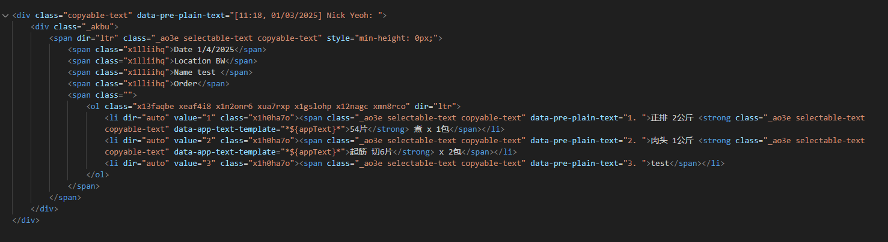
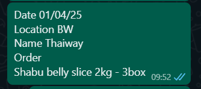
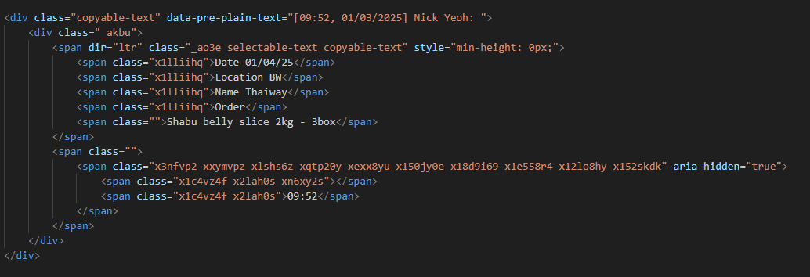

Follow the template
the date must be in dd-mm-yyyy or dd/mm/yyyy or dd.mm.yyyy (day and month and be one digit, year can be two digit)

Date  
Location  
Name  
Order  
  

for example, you can refer below

Date 23/2/2025  
Location PT  
Name The Great Hotpot Order  
Order pork shoulder - 1 block  
shrimp- 600g  
Tofu -400g  
    
    
  
---------------------
INSTALLATION
---------------------
1. npm install - to install all libraries and dependencies
2. download nvm and use node ver minimum 22 (23 also can)
3. import order sql into mysql workbench
4. run start.bat to start website  
  
-----------------------
WhatsApp Metadata Format
-----------------------

Configure the format of WhatsApp's `data-pre-plain-text` in `appsettings.json`:

- `timeFormat`: `24h` or `12h`
- `dateFormat`: `DD/MM/YYYY` or `MM/DD/YYYY`

For the client format `[7:30 PM, 11/24/2026]`, use `12h` and `MM/DD/YYYY`.
For `[19:30, 24/11/2026]`, use `24h` and `DD/MM/YYYY`.
Restart the scraper after changing the settings. These options apply to WhatsApp
message metadata, not the `Date` field inside an order message.

  
  
-----------------------
Whatsapp Format Message (2/3/2025)
-----------------------

For numbering formatted message  
  

  
  
  
For normal plain message   

  
  

-----------------------
Coding Logic
-----------------------
  

  
    
For numbering formatted message    
    
span._ao3e span:not(:has(ol)) - to capture the normal span message (date,location,name,order)  
span[data-pre-plain-text] - to capture numbering formatted message in whatsapp  
   
  
For normal plain message   
    
span._ao3e span:not(:has(ol)) - will already capture all of the messages  