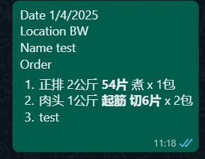
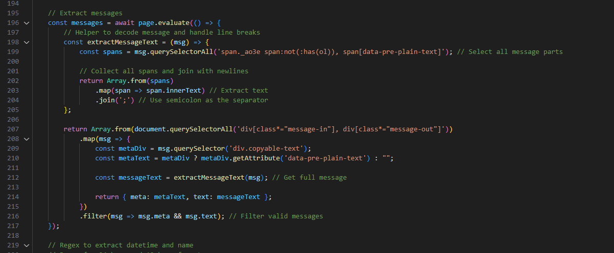

Follow the template
the date must be in dd-mm-yyyy or dd/mm/yyyy or dd.mm.yyyy (day and month and be one digit, year can be two digit)

Date  
Location  
Name  
Order  
  

for example, you can refer below

Date 23/2/2025
Location PT
Name The Great Hotpot Order
Order pork shoulder - 1 block
shrimp- 600g
Tofu -400g
  
  
  
---------------------
INSTALLATION
---------------------
1. npm install - to install all libraries and dependencies
2. download nvm and use node ver minimum 22 (23 also can)
3. import order sql into mysql workbench
4. run start.bat to start website  
  
  
  
-----------------------
Whatsapp Format Message
-----------------------
  
Example of whatsapp message format css selector (2/3/2025)

    

        
            Date 1/4/2025
            Location BW
            Name test 
            Order
            
                <ol class="x13faqbe xeaf4i8 x1n2onr6 xua7rxp x1gslohp x12nagc xmn8rco" dir="ltr">
                    <li dir="auto" value="1" class="x1h0ha7o">正排 2公斤 <strong class="_ao3e selectable-text copyable-text" data-app-text-template="*${appText}*">54片</strong> 煮 x 1包</li>
                    <li dir="auto" value="2" class="x1h0ha7o">肉头 1公斤 <strong class="_ao3e selectable-text copyable-text" data-app-text-template="*${appText}*">起筋 切6片</strong> x 2包</li>
                    <li dir="auto" value="3" class="x1h0ha7o">test</li>
                </ol>
            
        
    

span._ao3e span:not(:has(ol)) - to capture the normal span message (date,location,name,order)
span[data-pre-plain-text] - to capture numbering formatted message in whatsapp

  
    
For normal plain message   

    

        
            Date 01/04/25
            Location BW
            Name Thaiway
            Order
            Shabu belly slice 2kg - 3box
        
        
            
                
                09:52
            
        
    

span._ao3e span:not(:has(ol)) - will already capture all of the messages